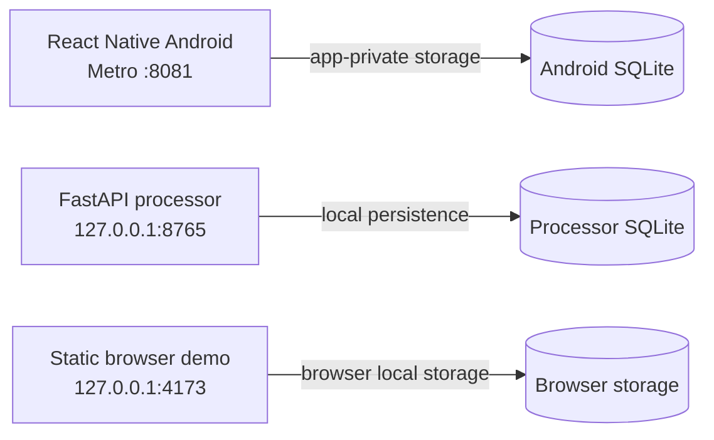

# Azure Debug Plan

> This plan is the source of truth for generating the local VS Code debug setup.
>
> **Status:** Implemented
> **Execution Mode:** Auto
> **executionMode:** auto
> **Created:** 2026-11-05T15:52:43+05:30
> **Last Updated:** 2026-11-05T16:06:33+05:30
>
> Local development only. No Azure resource, deployment, or application-behavior changes are in scope.

## Workspace Findings

- The Android client is React Native/TypeScript with local SQLite and Metro; the browser demo is standalone static HTML/JavaScript served locally.
- `processor/` is a separate FastAPI/SQLite service, bound to `127.0.0.1:8765`; its startup migration runner applies `processor/migrations/*.sql`.
- **The Android client and processor are currently independent.** `src/data/localApi.ts` referenced by `.azure/integration-plan.md` is absent, and the root README says the processor is not connected to the Android demo. Do not configure or imply an app-to-API connection.
- No Azure SDK/service dependencies or existing Compose files were found. No Azure emulator/container runtime is needed.
- Existing `.vscode/settings.json` contains workspace settings only; there are no `launch.json` or `tasks.json` files to preserve/merge.
- Existing local checks pass: Android Jest (2 suites/4 tests) and TypeScript check; processor pytest (14 tests). The processor suite reports a Starlette/httpx deprecation warning.

## Prerequisites

| Tool / Extension | Category | Service(s) | Installed | Version |
|------------------|----------|------------|-----------|---------|
| Node.js | Runtime | mobile-app | ✅ | 26.8.2 |
| npm | Package manager | mobile-app | ✅ | 11.19.1 |
| Python | Runtime | processor, browser-demo | ✅ | 3.14.7 |
| pip | Package manager | processor | ✅ | 26.2.1 |
| Android SDK | SDK | mobile-app | ✅ | Platform 35 and Build Tools 35.0.0 detected |
| Android SDK Platform Tools (adb) | Debug tool | mobile-app | ✅ | 1.0.41 |
| Android Emulator / configured AVD | Debug tool | mobile-app | ❌ | Emulator binary and Android 36 system image exist; `emulator -list-avds` and `adb devices -l` returned no targets |
| JDK | Runtime / SDK | mobile-app | ❌ | `java` not found on PATH; project requires JDK 17 |
| VS Code React Native Tools extension | VS Code extension | mobile-app | ❌ | `msjsdiag.vscode-react-native` not found in checked user extensions |
| VS Code Python extension | VS Code extension | processor | ✅ | 2026.11.2026102901 |
| Google Chrome | Browser | browser-demo | ✅ | 156.0.8078.80 |

> ⚠️ Action required before Android F5 validation: install/configure JDK 17 and put `java` on PATH; create an Android AVD or attach a device; install/enable the React Native Tools extension. The Android SDK binaries are at `%LOCALAPPDATA%\Android\Sdk`, but no `ANDROID_HOME`/`ANDROID_SDK_ROOT` was set and no `android/local.properties` exists; expose the SDK path to the React Native CLI (and platform-tools `adb` on PATH). The processor and browser demo can be run and tested without these Android prerequisites.

## Debug Configurations

| Generate | Debug Config Name | Service Label | Service Root | Project Type | Runtime | Version | Azure Dependencies |
|----------|--------------------|---------------|--------------|--------------|---------|---------|--------------------|
| [x] | Pocket Black Box Android (debug) | Pocket Black Box Android | ./apps/pocket-black-box-android | mobile-app | node-ts | 26.8.2 | — |
| [x] | Pocket Black Box Processor (debug) | Pocket Black Box Processor | ./processor | app-service | python | 3.14.7 | — |
| [x] | Pocket Black Box Browser Demo (debug) | Pocket Black Box Browser Demo | ./apps/pocket-black-box-android/demo-site | static-web | python | 3.14.7 | — |
| [x] | Debug All Local Services | Debug All Local Services | — | *Compound Config* | — | — | — |

Project Type Descriptions

| Project Type | Description |
|-------------|-------------|
| mobile-app | React Native Android application; Metro serves the development bundle and Android runs on an emulator or attached device. |
| app-service | Local FastAPI HTTP service with SQLite persistence. |
| static-web | Standalone static browser demo served by Python's local HTTP server. |
| *Compound Config* | Starts the selected independent local debug targets; it does not imply that the Android client calls the processor API. |

## Local Startup and Service Dependencies

| Service | Local startup | Local endpoint / port | Notes |
|---------|---------------|-----------------------|-------|
| Android client | From `apps/pocket-black-box-android/`: `npm start`; install/run with `npm run android` | Metro `127.0.0.1:8081` | Requires JDK 17, Android SDK, and an AVD or USB device. Uses app-private SQLite; no server is required for its current offline workflow. |
| Processor API | From `processor/`: `python -m app.main` | `http://127.0.0.1:8765` | SQLite defaults to `processor/data/pocket-black-box.sqlite3`; optional `PBB_DATABASE_PATH` override. SQL migrations run at startup. No seed data. |
| Browser demo | `py -m http.server 4173 --bind 127.0.0.1 --directory apps/pocket-black-box-android/demo-site` | `http://127.0.0.1:4173/` | Standalone HTML/JS; browser local storage is separate from Android and processor SQLite. |

The Android emulator/device is a separate local runtime, not an Azure emulator. The API binds only to host loopback and is smoke-tested from the development host; the Android application is not presently wired to it. Do not add `adb reverse` or change bind addresses unless a future, explicitly approved app/API integration requires it.

## Orchestrator

| Orchestrator | Container Runtime | Compose Command |
|--------------|-------------------|-----------------|
| Local development services only; no Azure emulators | Not required | — |

## Emulators

No Azure dependencies were detected; no Azurite, database container, or other Azure service emulator is needed. SQLite is local file storage, and the Android Virtual Device (when configured) is only a target device.

## Architecture Diagram

During local development, the Android app uses app-private SQLite, the processor API uses its own SQLite database on host loopback, and the browser demo uses browser local storage; these are independent data paths.

## Migrations

| Generate | Service | Migration Tool |
|----------|---------|----------------|
| [ ] | Pocket Black Box Processor | Raw SQL (`processor/migrations/*.sql`); `ReportRepository.migrate()` runs during API startup. No separate migration CLI/script exists, so do not invent one. |

## API Test Collections

| Generate | Service | Description |
|----------|---------|-------------|
| [x] | Pocket Black Box Processor | Windows PowerShell smoke scripts under `api-test-collections/pocket-black-box-processor/`; test report fixtures are uniquely identified and remain in the configured SQLite database because no delete route exists. Transcription expects 503 `TRANSCRIPTION_UNAVAILABLE` until a local Whisper runtime/model is configured. |

### GET /api/health `http-health`

### POST /api/reports `http-createReport`

### GET /api/reports `http-listReports`

### GET /api/reports/{report_id} `http-getReport`

### PATCH /api/reports/{report_id} `http-updateReport`

### GET /api/map `http-map`

### POST /api/triage `http-triage`

### POST /api/transcribe `http-transcribe`

## Convenience Scripts

No project script-runner changes are planned. Use existing `npm test`, `npm run typecheck`, and `python -m pytest` commands; generated VS Code tasks and API smoke-test invocations should call these existing entry points without modifying app behavior.

## Debug Configuration Checklist

❌ Pocket Black Box Android (debug) — Metro 0.81.5 reached `Dev server ready`; Android install/debug launch remains blocked because JDK 17 is absent from PATH, no AVD/device is configured, and React Native Tools is not installed.
✅ Pocket Black Box Processor (debug) — Python module startup reached Uvicorn on `127.0.0.1:8765`; `/api/health` returned 200 and all eight generated API smoke-test collections passed (including 404, structured 422, and planned transcription 503 cases) against a temporary SQLite database.
✅ Pocket Black Box Browser Demo (debug) — Existing local demo returned HTTP 200 with the expected page marker; generated startup task detected and reused it.
❌ Debug All Local Services — Task graph references resolve and each service was independently checked, but the compound F5/debugger run could not be completed while the Android prerequisites above are missing.
